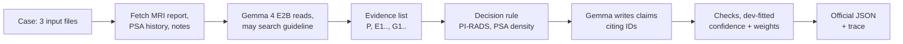

# CHIMERA-Agent

UCU "Artificial Intelligence" course project, 2026. Oleksii Lasiichuk, Vladyslav Shymanovskyi.

Task 1 of [CHIMERA-agent challenge](https://chimera-agent.grand-challenge.org/): read prostate cancer patient case,
decide biopsy yes/no, explain why. Explanation must be checkable: each claim points to evidence it came from.
Research prototype, not clinical tool.

## How agent_v3 works



Organizers' parts, reused unchanged: Gemma 4 E2B, MCP tools, EAU guideline index and search, output schema,
evaluator. Rest ours.

## Systems

| System | What |
|---|---|
| baseline | Organizers' agent. Tool loop, then one call fills form from last message. |
| agent_v1 | Evidence list with IDs; separate decision call writes 2-4 claims citing IDs; checks; trace per case. |
| agent_v2 | agent_v1 + our prompts: only real Task 1 tools, prior positive biopsy = known cancer. |
| agent_v3 | Always fetch MRI, PSA, notes; PI-RADS rule decides; confidence and weights from table fitted on dev. |

## Results (dev split, 60 cases)

| System | Task 1 score (95% CI) | F1 yes | Correct "no" (of 23) |
|---|---|---|---|
| baseline | 0.662 (0.571-0.746) | 0.804 | 5 |
| agent_v1 | 0.669 (0.575-0.750) | 0.809 | 6 |
| agent_v2 | 0.660 (0.564-0.745) | 0.795 | 7 |
| agent_v3 | 0.707 (0.614-0.790) | 0.818 | 8 |

- v3 best, not yet significant: gain +0.044, 95% CI -0.002 to +0.091. Its table fitted on dev, so test split decides.
- Without decision rule v3 scores 0.705: gain comes from documents read and fitted fields, not decisions.
- Patients with earlier positive biopsy stay at chance for every method tried.
- Test split (31 cases) not run yet.

Details: [results/](results/README.md).

## Run

Python 3.12, [uv](https://docs.astral.sh/uv/). Agent needs Linux/macOS/WSL and GPU; full runs on Kaggle
([notebooks/04_agent_v3_run.ipynb](notebooks/04_agent_v3_run.ipynb)).

```
uv venv --python 3.12 .venv
uv pip install --python .venv/bin/python -r requirements.txt
bash scripts/fetch_evaluator.sh
bash scripts/setup_agent.sh
.venv/bin/python -m unittest discover -s tests -t .
.venv/bin/python -m chimera_agent.run --name my_run --system agent_v3 --all-dev
.venv/bin/python -m evaluation.score results/my_run --name my_run --system agent_v3 --temperature 1.0
```

More: [chimera_agent/README.md](chimera_agent/README.md), [evaluation/README.md](evaluation/README.md).
Challenge data goes to `data/task1/` (not in repo).

## Layout

```
chimera_agent/  agent: runner, graph, decision step, evidence list, prompts
evaluation/     official scorer, statistics, calibration fit, claim audit
configs/        settings, calibration table
splits/         fixed dev/test split
notebooks/      Kaggle runs, data analysis
results/        aggregate reports only
tests/          unit tests, synthetic data
```

## Rules

- Agent gets only 3 input files per case. Answer files only for evaluator.
- Dev for development, test only for final comparison. Data analysis saw all 91 labeled cases before split.
- Patient data and raw runs stay local. Only aggregate numbers in repo.

Proposal: [proposal_shymanovskyi_lasiichuk.pdf](proposal_shymanovskyi_lasiichuk.pdf).
